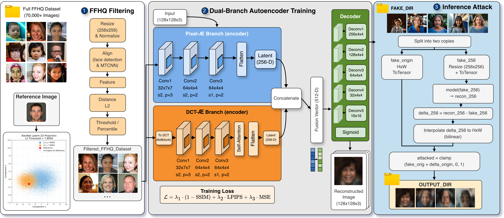

# DAELTA: Manifold-Guided Adversarial Attack of Deepfake Detectors via Dual-Branch Autoencoder Projection

> **ACM International Conference on Multimedia (MM '26)**  
> November 10–14, 2026 · Rio de Janeiro, Brazil  
> DOI: [10.1145/3767308.3837703](https://doi.org/10.1145/3767308.3837703)

---

## Authors

| Name | Affiliation | Email |
|------|-------------|-------|
| Stefano Cirillo | Dept. of Computer Science, University of Salerno | scirillo@unisa.it |
| Luigi Di Biasi | Dept. of Computer Science, University of Salerno | ldibiasi@unisa.it |
| Giuseppe Genito | Dept. of Computer Science, University of Salerno | ggenito@unisa.it |
| Antonio Landi | Dept. of Computer Science, University of Salerno | a.landi128@studenti.unisa.it |
| Mattia Maucioni | Dept. of Computer Science, University of Salerno | m.maucioni@studenti.unisa.it |
| Dorotea Serrelli | Dept. of Computer Science, University of Salerno | d.serrelli1@studenti.unisa.it |
| Giandomenico Solimando | Dept. of Computer Science, University of Salerno | gsolimando@unisa.it |

---

## Abstract

We present **DAELTA**, a *Dual-branch AutoEncoder Latent Transformation Attack* framework designed to generate adversarial versions of deepfake images in a **transfer black-box** setting, without optimizing perturbations against a specific detector. DAELTA projects each input through an autoencoder trained exclusively on a curated subset of real Flickr-Faces-HQ (FFHQ) images. The architecture encodes each image via two parallel branches: one operating on **RGB pixels** and the other on **log-scaled RGB DCT representations** augmented with self-attention. The resulting 256-dimensional latent vectors are concatenated and decoded by a shared transposed-convolutional decoder. Training minimizes a composite perceptual loss combining SSIM, LPIPS, and MSE, following the guidelines of the ACM Multimedia Fake Face Detection Challenge (AADD 2026). DAELTA demonstrates cross-model transferability with an **Attack Success Rate (ASR) above 86%** on six out of eight black-box detectors, outperforming gradient-based baselines.

---

## Architecture



*Overview of the DAELTA approach: (1) real-face subset selection from FFHQ; (2) dual-branch autoencoder encoding; (3) inference-time delta injection.*

---

## Results

### Main Results (AADD 2026 Challenge)

| Setting | Challenge Score *S* | SSIM | PSNR (dB) | LPIPS | FID |
|---------|------------------:|-----:|----------:|------:|----:|
| White-box (2 detectors) | 2003.41 | 0.7513 ± 0.0825 | 15.97 ± 2.14 | 0.3906 ± 0.0790 | 186.49 |
| Black-box (8 detectors) | 6970.30 | — | — | — | — |

### ASR (%) vs. All Detectors

| Detector | Type | PGD | APGD | MI-FGSM | **DAELTA** |
|----------|------|----:|-----:|--------:|-----------:|
| ViT-B/16 | White-box | 95.88 | **96.94** | 25.25 | 96.12 |
| DenseNet121-DCT | White-box | 57.94 | 18.50 | 10.88 | **93.44** |
| ResNet50 | Black-box | 5.25 | 5.94 | 6.62 | **98.19** |
| DenseNet121 | Black-box | 6.00 | 6.81 | 7.94 | **86.38** |
| DINOv2 | Black-box | **9.44** | 9.00 | 9.06 | 5.13 |
| F3Net | Black-box | 9.25 | 10.75 | 16.25 | **75.06** |
| Xception | Black-box | 18.94 | 19.25 | 25.56 | **90.62** |
| UCF | Black-box | 15.44 | 16.88 | 16.12 | **99.88** |
| EfficientNet-B4 | Black-box | 11.19 | 11.75 | 12.12 | **96.25** |
| SPSL | Black-box | 16.19 | 17.25 | 19.69 | **88.38** |

DAELTA outperforms all gradient-based baselines on 9 out of 10 detectors in the black-box setting. The only exception is DINOv2, which remains robust to all tested attacks.

---

## Requirements

```
torch==2.5.1+cu121
torchvision==0.20.1+cu121
Pillow==12.2.0
lpips==0.1.4
torch-dct==0.1.6
pytorch-msssim==1.0.0
```

Install via:

```bash
pip install -r requirements.txt
```

> Requires CUDA 12.1 and a compatible NVIDIA GPU. CPU-only inference is supported but significantly slower.

---

## Pre-trained Weights

Pre-trained DAELTA weights (trained on the 14K FFHQ subset, loss weights λ₁=0.30, λ₂=0.60, λ₃=0.10) are available at the links listed in [`pth_links.md`](pth_links.md).

> Links are updated periodically to ensure availability.

---

## Usage

### 1. Training

Edit the path configuration at the top of `train-ae-daelta.py`:

```python
IMG_DIR          = '/path/to/training/images'   # real FFHQ images (14K subset)
SAVE_PATH        = '/path/to/output/daelta.pth'
METRICS_SAVE_PATH= '/path/to/output/daelta-metrics.json'
CHECKPOINT_DIR   = '/path/to/output/daelta-checkpoints'
```

Then run:

```bash
python train-ae-daelta.py
```

**Key hyperparameters** (defaults reproduce the paper's best configuration):

| Parameter | Value |
|-----------|-------|
| Image size | 256 × 256 |
| Latent dim | 256 (512 fused) |
| Batch size | 32 |
| Epochs | 15 |
| Learning rate | 1e-4 |
| Early stopping patience | 7 |
| λ₁ (SSIM) | 0.30 |
| λ₂ (LPIPS) | 0.60 |
| λ₃ (MSE) | 0.10 |

### 2. Attack (Inference)

Edit the path configuration at the top of `attack-ae-daelta.py`:

```python
WEIGHTS_PATH = '/path/to/model/daelta.pth'
FAKE_DIR     = '/path/to/input/fake/images'
OUTPUT_DIR   = '/path/to/output/adversarial/images'
N_IMAGES     = None  # set to an integer to process only the first N images
```

Then run:

```bash
python attack-ae-daelta.py
```

The script loads the trained DAELTA weights, processes each fake image with a single forward pass, computes the reconstruction delta at 256×256, upsamples it via bilinear interpolation to the original resolution, and saves the adversarial output.

---

## Repository Structure

```
DAELTA/
├── train-ae-daelta.py      # Training script
├── attack-ae-daelta.py     # Inference / attack script
├── requirements.txt        # Python dependencies
├── pth_links.md            # Links to pre-trained weights
└── img/
    └── pipeline_500_hor.png  # Architecture overview figure
```

---

## Datasets

- **Training**: a filtered 14K-image subset of [FFHQ](https://github.com/NVlabs/ffhq-dataset), selected via AlexNet-based nearest-neighbour filtering around a pivot image (21st percentile of L2 feature distances).
- **Evaluation**: the AADD 2026 challenge test set (1,600 fake images), provided by the [challenge organizers](https://iplab.dmi.unict.it/mfs/acm-aadd-challenge-2026/).

> **Note**: training and test images are **not distributed** in this repository. FFHQ is subject to its own license; the AADD test set belongs to the challenge organizers.

---

## Citation

If you use DAELTA in your research, please cite:

```bibtex
@inproceedings{cirillo2026daelta,
  author    = {Cirillo, Stefano and Di Biasi, Luigi and Genito, Giuseppe and
               Landi, Antonio and Maucioni, Mattia and Serrelli, Dorotea and
               Solimando, Giandomenico},
  title     = {Manifold-Guided Adversarial Attack Of Deepfake Detectors Via
               Dual-Branch Autoencoder Projection},
  booktitle = {Proceedings of the 34th ACM International Conference on Multimedia},
  series    = {MM '26},
  year      = {2026},
  month     = {November},
  address   = {Rio de Janeiro, Brazil},
  publisher = {ACM},
  doi       = {10.1145/3767308.3837703},
  isbn      = {979-8-4007-2213-4/2026/11}
}
```

---

## License

This code is released for research purposes under [CC BY-NC-ND 4.0](https://creativecommons.org/licenses/by-nc-nd/4.0/).

---

## Acknowledgements

This work was developed as part of the [ACM Multimedia Fake Face Detection Challenge (AADD 2026)](https://iplab.dmi.unict.it/mfs/acm-aadd-challenge-2026/).
